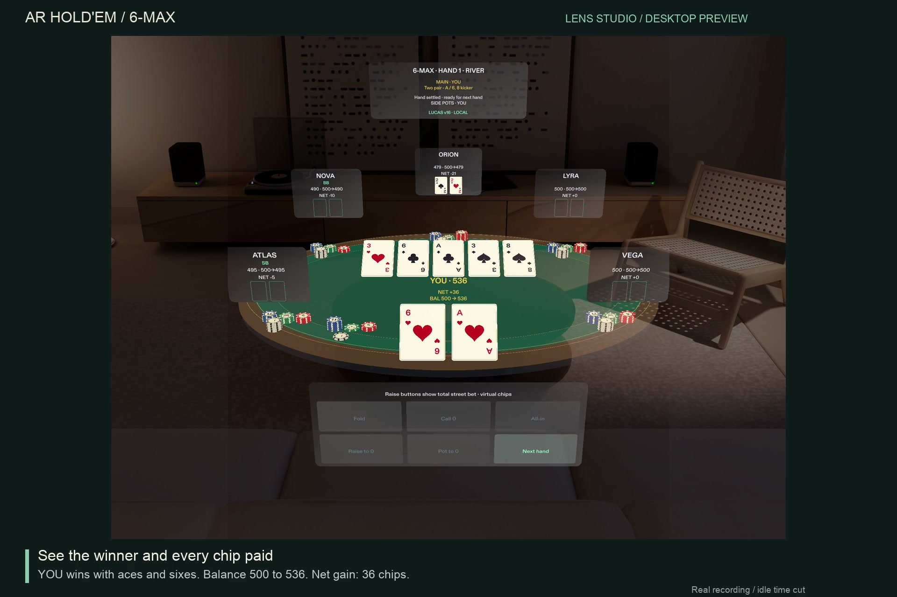

# AR Hold’em

[](https://github.com/rzr002/ar-holdem/actions/workflows/tests.yml)

AR Hold’em is a six-seat Texas Hold’em game for the SPECS Lens Studio preview. Play from the near seat against five computer opponents around a spatial table. The default opponent is local Lucas v16, a rule-based poker program; optional Codex CLI and OpenAI-compatible API modes are available. Chips are virtual.

This repository includes copied Hold’em engine, strategy and terminal-game files from [terminal-holdem](https://github.com/rzr002/terminal-holdem), pinned in [`ar/SOURCE_PROVENANCE.json`](ar/SOURCE_PROVENANCE.json), alongside the AR Lens, bridge and API adapter. See the [reuse and license disclosure](ar/lens-studio/ARHoldem/devpost/REUSE_DISCLOSURE.md); the project is not claimed to have been built entirely from scratch.

## Quick start

Clone the public repository, then run the commands below from its root:

```bash
git clone https://github.com/rzr002/ar-holdem.git
cd ar-holdem
```

Use Python 3.11 or 3.13 and Lens Studio 5.22+ (prepared with 5.23.2). Python 3.13 needs a C compiler to build the pinned `eval7` source distribution; on macOS, install Xcode Command Line Tools. Python 3.11 can use the available wheel. To prepare the default Lucas opponent:

```bash
python3 -m venv .venv
.venv/bin/python -m pip install --upgrade pip
.venv/bin/python -m pip install -r requirements-lucas-build.txt
.venv/bin/python -m pip install --no-build-isolation -r requirements-lucas.txt
./ar/run.sh
```

Open `ar/lens-studio/ARHoldem/SpecsBaseTemplate.esproj` in Lens Studio, choose the SPECS Interactive Preview, and play with the native preview controls. The bridge listens on local loopback, so run it and Lens Studio on the same computer. This is a desktop simulation; physical SPECS hardware has not been tested.

See the [bridge and API reference](ar/README.md), [fresh-checkout walkthrough](ar/lens-studio/ARHoldem/devpost/RUNNING.md), and [Chinese play notes](ar/试玩说明.md).

## Current demo

[](ar/demo/ARHoldem-demo-paced-20261031.mp4)

The current demo is [a 58-second silent 1920×1280 recording](ar/demo/ARHoldem-demo-paced-20261031.mp4) from Lens Studio's SPECS desktop preview. It shows a complete hand recorded with the native LEAF `DefaultLeafInteractor` and UIKit buttons. It is not physical hand tracking. The hand is YOU `6h Ah` against five local Lucas opponents; the board is `3h 6c Ac 3s 8s`, and YOU wins with two pair, finishing at 536 chips (`NET +36`). Gameplay remains at 1× speed; only leading and trailing idle time was trimmed. See the [video script and timeline](ar/lens-studio/ARHoldem/devpost/VIDEO_SCRIPT.md) and [demo asset notes](ar/demo/README.md).

The default opponent is Lucas v16, a local rules/equity and strategy program, not an LLM. An external API mode is optional and was not used in this recording. The public repository is [github.com/rzr002/ar-holdem](https://github.com/rzr002/ar-holdem); an anonymous clone was verified on 2026-10-31 at commit `7660c754`. The cloned repository included 56 asset/package files (10,589,729 bytes); six package ZIP archives passed CRC validation and contained no LFS pointers. The Lucas bridge started from that clone, completed a hand through the river, conserved all 3,000 chips, and reported no errors. The demo has not been uploaded to YouTube.

## Project and submission materials

- [Run instructions](ar/lens-studio/ARHoldem/devpost/RUNNING.md)
- [Official requirements and current status](ar/lens-studio/ARHoldem/devpost/REQUIREMENTS.md)
- [English project description](ar/lens-studio/ARHoldem/devpost/PROJECT_DESCRIPTION.md)
- [Reuse and third-party license disclosure](ar/lens-studio/ARHoldem/devpost/REUSE_DISCLOSURE.md)
- [Licensing boundaries and notices](LICENSES.md)
- [Spatial design brief](ar/lens-studio/ARHoldem/devpost/design-brief.md)

## Validation

On the current local revision, 147 Python tests passed in 16.939 seconds and the Node presentation test passed. A fresh-clone Lucas bridge hand also completed through the river with all 3,000 chips conserved and no error. These checks do not establish native Lens Studio, physical-device, or headset behavior. The workflow badge above links to GitHub Actions for its current status.

## Provenance and behavior

`ar/SOURCE_PROVENANCE.json` records the source repository and commit. Lucas v16 is MIT-licensed; its notice is preserved. Historical Codex/Luna results in `ar/verification/` describe earlier revisions and are not evidence for the current Lucas-default demo. See [ar/README.md](ar/README.md) for controls, API behavior and limitations.
